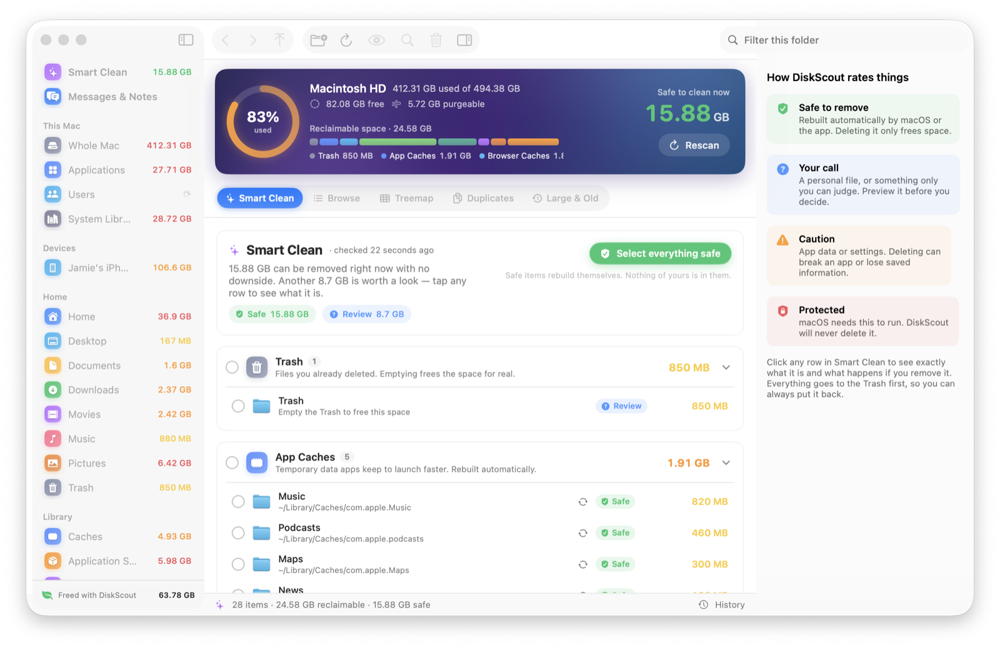
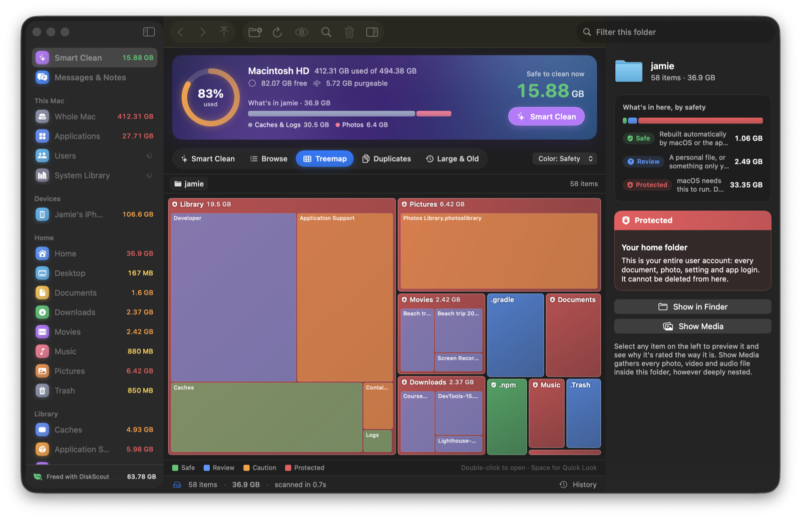
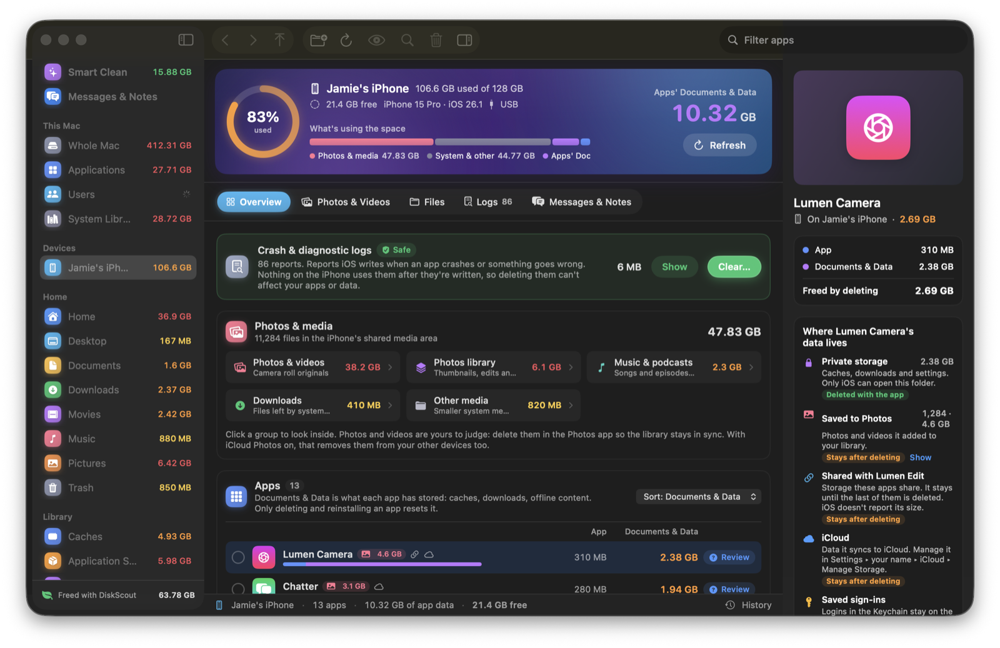
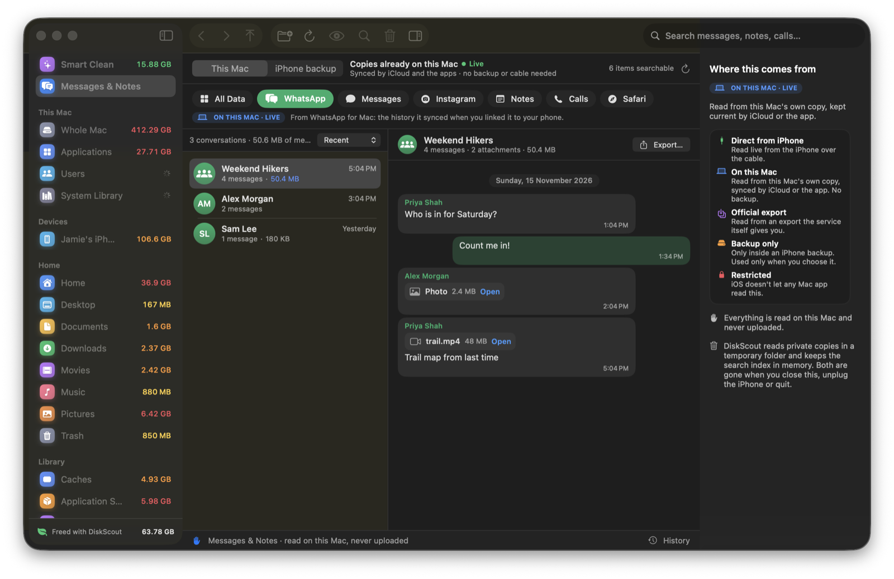
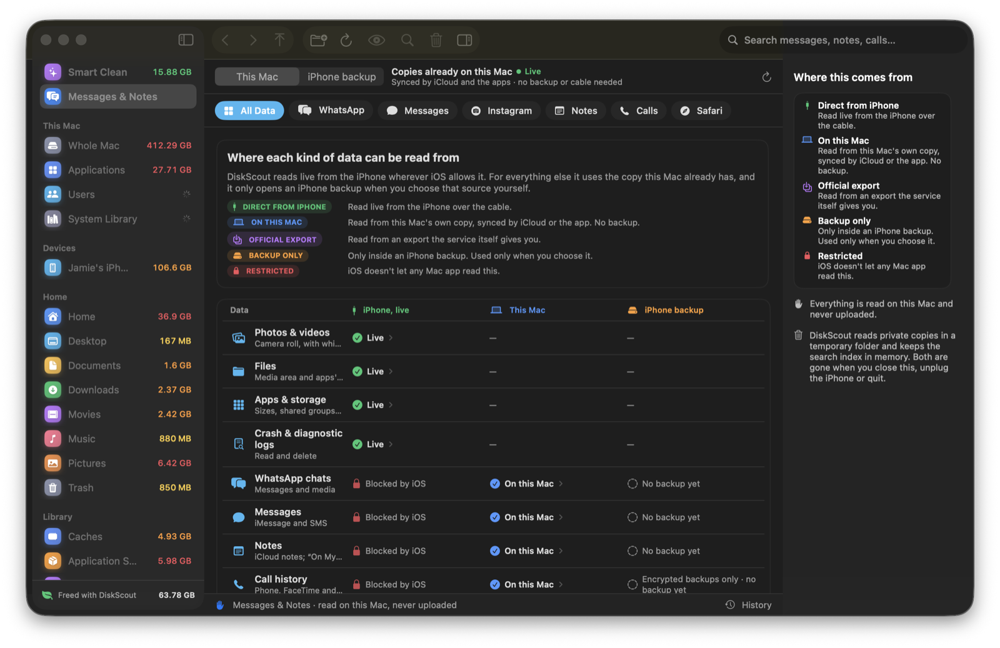
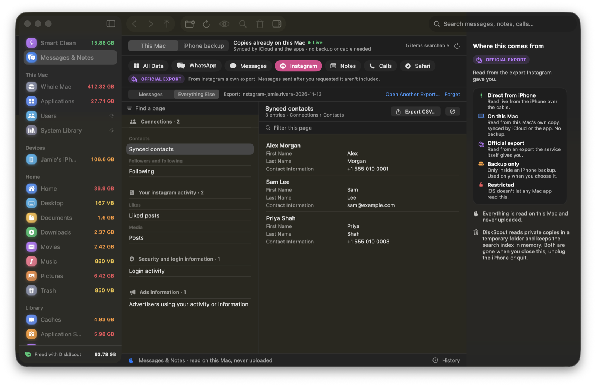

<p align="center">
  
</p>

<h1 align="center">DiskScout</h1>

<p align="center">
  <strong>Know what's safe to delete.</strong><br>
  A free, open-source disk cleaner for macOS that rates every file before you remove it,<br>
  and shows what's filling up your iPhone too.
</p>

<p align="center">
  
  
  
  <a href="LICENSE"></a>
  <a href="CONTRIBUTING.md"></a>
</p>

<p align="center">
  <a href="#features">Features</a> •
  <a href="#install">Install</a> •
  <a href="#privacy">Privacy</a> •
  <a href="#contributing">Contributing</a> •
  <a href="#faq">FAQ</a>
</p>

<picture>
  <source media="(prefers-color-scheme: dark)" srcset="docs/screenshots/smart-clean-dark.png">
  
</picture>

Every disk cleaner can find big files. The hard part is knowing which ones you can delete without breaking something. DiskScout answers that for **every file and folder it shows you**: a safety rating, a one-line reason, and, when something rebuilds itself, what recreates it. Nothing is removed without a review, and everything goes to the Trash first, with Undo.

> All screenshots use invented sample data. See [Sample data](#sample-data) to reproduce them.

## Four safety levels


| Level | What it covers | What DiskScout does |
|---|---|---|
| 🟢 **Safe** | Caches, logs, build products, package caches, device symbols, window state. Rebuilt automatically. | One click selects all of it. |
| 🔵 **Review** | Your own files, installers, archives, device backups, leftovers from apps you removed. Only you can judge. | Shows a preview and explains it. Normal confirmation. |
| 🟠 **Caution** | App data: Application Support, Containers, Preferences, iCloud Drive, Mail, browser profiles. | Asks for an extra acknowledgement before it goes. |
| 🔴 **Protected** | `/System`, `/usr`, Keychains, SSH keys, your home folder's structure, the Library root. | Refuses to delete it. |

The rules live in one auditable file, [`SafetyClassifier.swift`](Sources/DiskScout/Core/SafetyClassifier.swift), and the tests in [`Tests/DiskScoutTests`](Tests/DiskScoutTests) pin the important verdicts. Making those rules smarter is the most useful thing you can contribute.

## Features

### 🧹 Smart Clean

Sizes the usual junk in parallel and sorts it by how safe it is to remove:

- App and browser caches, logs and crash reports
- Xcode DerivedData, device support symbols, simulators and previews
- npm, Homebrew, pip, Gradle, Cargo, CocoaPods, Docker and other developer caches
- Installers and disk images left in Downloads, Mail attachment copies, old iPhone backups
- **Leftovers from apps you've uninstalled**, found by matching folders against the bundle IDs of installed apps

Press **Select everything safe**, then **Review & Clean**.

### 🗺️ See where the space went



- **Browse**: a fast parallel scanner with a sortable list, share bars, safety badges, filtering, Quick Look (Space) and keyboard navigation.
- **Treemap**: an animated, nested map coloured by safety, file type or size.
- **Duplicates**: groups files by size, then confirms them with SHA-256. Keep the newest, the oldest or the shortest path in one click.
- **Large & Old**: the biggest files, or files you haven't opened in months.
- **Show Media**: every photo, video and audio file inside a folder, however deeply nested, in one gallery.

### ✅ Review, Trash, Undo

Every deletion goes through a review sheet that lists each item with its rating and reason. Caution items need an explicit acknowledgement, and protected items are skipped with an explanation. Items go to the Trash, the toast offers Undo, and the History window can put anything back.

### 📱 iPhone and iPad



Plug in an iPhone or iPad and it appears under **Devices**:

- **Storage**: apps, apps' Documents & Data, photos and media, and system, at a glance.
- **Apps**: every app with its size and its Documents & Data, rated before you delete it. Apps holding chats, two-factor codes, wallets or your documents are marked Caution.
- **Where an app's data lives**: its private storage, the photos it saved to your library, storage it shares with other apps, iCloud and saved sign-ins, and what stays behind after you delete it.
- **Photos & Videos, Files and Logs** tabs, with a **Saved by** filter (Camera, WhatsApp, screen recordings, AirDrop…), Quick Look and Copy to Mac.
- **Crash logs** you can clear in one go.

There's no Trash on an iPhone, so deleting an app there is permanent and DiskScout never rates an app Safe. It talks to the device through Apple's MobileDevice framework, the one Finder uses, loaded at runtime. Works over USB and Wi-Fi sync.

### 💬 Messages & Notes, without a backup



Read your conversations and notes from copies that are already on your Mac:

- **WhatsApp** (from WhatsApp for Mac), **Messages** (iMessage and SMS), **Notes**, **call history** and **Safari** bookmarks and history.
- One conversation viewer for every service, with transcript, CSV and bookmark exports.
- **Search across everything** with `from:`, `in:`, `before:`, `after:` and quoted phrases. The index lives only in memory.
- **Live**: a section re-reads itself a few seconds after new messages, notes or calls arrive.

Every section is labelled with where its data came from, and DiskScout never switches to another source on its own:



| Data | Live from the iPhone | On this Mac | From a backup you choose |
|---|:---:|:---:|:---:|
| Photos, videos, shared files, apps, crash logs | ✅ | | |
| WhatsApp chats | | ✅ WhatsApp for Mac | ✅ |
| Messages, Notes | | ✅ via iCloud | ✅ |
| Call history, Safari history | | ✅ via iCloud | ✅ encrypted backups only |
| Instagram messages and account data | | ✅ Instagram's own export | |
| Other apps' private folders, Keychain, Health | ❌ iOS doesn't allow it | | |

Backups (encrypted or not) are unlocked on your Mac with CommonCrypto. The password never leaves the Mac, and decrypted copies are deleted when you lock, quit, or next launch.

### 📸 Everything Instagram has about you



Open the export Instagram gives you (**Settings ▸ Accounts Center ▸ Your information and permissions ▸ Download your information**), as the `.zip` or the unzipped folder, HTML or JSON. DiskScout shows your direct messages in the conversation viewer, and every other page of the export too: synced contacts, followers and following, logins and devices, searches, likes, comments, stories viewed, and what advertisers know. You can filter any page or export it as CSV.

## Privacy

- **Nothing leaves your Mac.** DiskScout makes no network requests: no analytics, no accounts, no telemetry.
- Live databases are never opened. DiskScout reads private copies in a folder only you can open, and deletes them when you're done.
- The Photos database copied from an iPhone (to tell which app saved each photo) is deleted as soon as it has been read.
- Backup passwords are kept in your Keychain only if you ask.
- Reading WhatsApp, Messages, Notes and Safari data needs Full Disk Access. DiskScout tells you why and takes you to the right setting.

## Install

**Requirements:** macOS 14 Sonoma or later. Full Disk Access is optional but recommended, since without it macOS hides some folders.

Download the latest build from [Releases](https://github.com/connectstack/diskscout/releases). If there isn't one yet, building it takes a couple of minutes:

```bash
git clone https://github.com/connectstack/diskscout.git
```

```bash
cd diskscout && swift run -c release
```

Or open `Package.swift` in Xcode 15 or later and press ⌘R. To make a standalone `DiskScout.app`, run `Scripts/build-app.sh` (it's ad-hoc signed unless you set `SIGN_ID`).

## Contributing

Contributions are very welcome, from a single new cache location to a whole feature. Start with [CONTRIBUTING.md](CONTRIBUTING.md). The short version:

- **Safety first.** A wrong "Safe" rating can destroy someone's data. Every rule change comes with a test, and when in doubt the rating is Review.
- **Privacy first.** No network calls, and only invented data in tests, screenshots and bug reports.
- Run `swift test` before opening a pull request.

Good first contributions: cleanup locations DiskScout doesn't know yet, safety rules for apps you use, and bug reports from other Mac and iPhone models.

### Sample data

Debug builds can run entirely on invented data, so you can work on any screen without your own files, phone or messages showing up:

```bash
swift run DiskScout --sample-home --sample-device
```

| Flag | What it does |
|---|---|
| `--sample-home` | Uses an invented home folder full of caches, Xcode junk, leftovers, projects and photos. Built in `~/Library/Caches/DiskScout-sample` from APFS clones, so it costs about 1 GB of real disk. |
| `--sample-device` | Shows an invented iPhone ("Jamie's iPhone") instead of real ones. No device needed. |
| `--demo-mac-data` | Invented WhatsApp, Messages, Notes, call and Safari data for Messages & Notes. |
| `--demo-backup` | An invented encrypted iPhone backup (password `sample-password`). |
| `--demo-instagram-html` | An invented Instagram export, including contacts, followers, logins and likes. |
| `--scan <folder> --mode <smart\|browse\|treemap\|duplicates\|large>` | Opens straight into a scan. |
| `--device --device-tab <photos\|files\|logs\|messages>` | Opens the first iPhone on a tab. |
| `--backup-section <name>`, `--backup-search <text>`, `--instagram-page <text>` | Opens a Messages & Notes section, a search, or an Instagram page. |
| `--appearance <light\|dark>` | Forces light or dark mode. |
| `--dump-layout` | Writes every window's view frames to a file in the temporary folder, for layout bugs. |

## Project layout

```
Sources/DiskScout/
  Core/
    SafetyClassifier.swift     the rating rules (the heart of the app)
    CleanupScanner.swift       Smart Clean categories and leftover detection
    ScanEngine.swift           parallel scanner with streaming progress
    TrashManager.swift         Trash, Put Back, history
    DuplicateFinder.swift, Treemap.swift, DiskWalker.swift, QuickLook.swift, …
    MobileDevice.swift         bridge to Apple's MobileDevice framework (lockdown, AFC)
    IOSDevice.swift            connected iPhones: storage, apps, icons, media, uninstall
    DeviceFiles.swift          device files, thumbnails, crash log names
    PhotoSources.swift         which app saved each photo
    Backup/                    Mac copies, backups, WhatsApp, Messages, Notes, calls, Safari,
                               Instagram export, search index
    SampleHome.swift           the invented home folder (debug builds)
    AppModel.swift             app state, trash plans, undo
  Views/                       SwiftUI views, one file per area
Scripts/                       build-app.sh, make-dmg.sh, make-icon.swift
Tests/DiskScoutTests/
```

## How it works

- Sizes are allocated size on disk, matching Finder's "size on disk". Hidden files are included by default, because that's where developer junk hides.
- App bundles and other packages count as single items.
- Whole-Mac scans skip `/System/Volumes` and `/Volumes`, so firmlinks and external disks aren't counted twice.
- Emptying the Trash is handed to Finder (macOS asks for the Automation permission the first time).
- A normal iPhone offers no way into other apps' private data: `house_arrest VendContainer` and `file_relay` are refused, which is why chats come from your Mac's copies, an export, or a backup.

## Releasing

For maintainers making a signed, notarized build:

```bash
SIGN_ID="Developer ID Application: Your Name (TEAMID)" Scripts/build-app.sh
```

```bash
SIGN_ID="Developer ID Application: Your Name (TEAMID)" Scripts/make-dmg.sh
```

```bash
xcrun notarytool submit dist/DiskScout-2.0.0.dmg --keychain-profile "notary" --wait && xcrun stapler staple dist/DiskScout-2.0.0.dmg
```

Set up the `notary` profile once with `xcrun notarytool store-credentials`, and bump `VERSION=` in `build-app.sh` for each release.

## FAQ

**Will it delete something important?**
Not without telling you. Protected items can't be deleted at all, Caution items need an extra confirmation, and everything goes to the Trash first, so you can put it back.

**Why isn't it on the Mac App Store?**
A disk cleaner has to read `~/Library` (ideally with Full Disk Access) and move arbitrary files to the Trash. App Store sandboxing doesn't allow that.

**Can it read my WhatsApp chats straight off the iPhone?**
No. iOS doesn't let any Mac app into another app's private storage. DiskScout reads the copy WhatsApp for Mac keeps, or an iPhone backup you choose, and always says which.

**Is it really free?**
Yes. No trial, no account, no in-app purchase. The whole app is open source under the Apache License 2.0.

## License

DiskScout is free and open source under the [Apache License 2.0](LICENSE).

WhatsApp, Instagram, iPhone, iPad, Safari and other product names are trademarks of their owners. DiskScout isn't affiliated with or endorsed by them.
