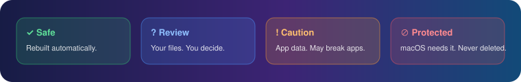

# DiskScout

**Know what's safe to delete.**

DiskScout is a macOS disk-cleanup app built around the one question every other cleaner skips: *is it safe to remove this?* Every file and folder gets a safety rating and a plain-English explanation, so people stop guessing and stop breaking things.



| Level | Meaning | What DiskScout does |
|---|---|---|
| 🟢 **Safe** | Caches, logs, build products, package caches, device symbols, window state. Rebuilt automatically. | One click selects all of it. |
| 🔵 **Review** | Personal files, installers, archives, iPhone backups, leftovers from uninstalled apps. Only the user can judge. | Preview + explanation, normal confirmation. |
| 🟠 **Caution** | App data: Application Support, Containers, Preferences, iCloud Drive, Mail, Chrome profile… | Extra acknowledgement in the review sheet. |
| 🔴 **Protected** | `/System`, `/usr`, Keychains, SSH keys, home-folder structure, Library root… | Refuses to delete. |

The rules live in one auditable file: [SafetyClassifier.swift](Sources/DiskScout/Core/SafetyClassifier.swift). Tests in [Tests/DiskScoutTests](Tests/DiskScoutTests) pin the important verdicts.

## Features

- **Smart Clean** – sizes known junk locations in parallel (app & browser caches, logs, Xcode DerivedData / DeviceSupport / simulators, npm/Homebrew/pip/Gradle/Cargo/Docker caches, Mail attachment copies, iOS backups, installers in Downloads, saved window state) and **finds leftovers from uninstalled apps** by matching reverse-DNS folders against installed bundle IDs. "Select everything safe" → "Review & Clean".
- **Browse** – fast parallel scanner (fans out across cores near the top of the tree, streams top-level results while scanning), sortable list with share bars, safety badges, filter field, multi-select, keyboard navigation (Space = Quick Look, ⌘⌫ = Trash, ⌘↑ = up).
- **Treemap** – nested, animated squarified treemap coloured by safety, file type or size.
- **Duplicates** – size-bucketed SHA-256 duplicate finder with "keep newest / oldest / shortest path" auto-selection.
- **Large & Old** – biggest files, or files unused for N months, with a "personal files only" filter.
- **Inspector** – Quick Look thumbnail, kind, dates, path, category and the full safety card for whatever is selected. Full Quick Look panel on Space.
- **Review sheet** – every deletion is listed with its rating and reason; Caution items need an explicit acknowledgement; protected items are skipped and say why.
- **iPhone & iPad** – a connected device appears under *Devices* in the sidebar: storage breakdown (apps, apps' Documents & Data, photos & media, system), every App Store app with its app size and Documents & Data, safety-rated app deletion, crash-log cleanup, and sizes of the shared media area. Tabs mirror the Mac views: **Photos & Videos** (thumbnail grid of the camera roll, largest first, video lengths, Live Photo and screenshot filters), **Files** (browse the media area with folder sizes) and **Logs** (every crash/diagnostic report, typed and dated). **Show Media** (Files path bar, a folder's context menu, the inspector or ⇧⌘M) opens a gallery of every photo, video and audio file inside an iPhone folder, however deep, just like the Mac's — it answers instantly from the background walk once that has finished. **Where app data lives**: the app inspector maps each app's data — private storage (size from iOS), its shared Documents (browsable in Files for apps that share files), photos and videos it saved (read from the Photos database: `ZIMPORTEDBYBUNDLEIDENTIFIER`), App Group storage shared with other installed apps, iCloud and Keychain — and marks what is deleted with the app versus what stays; the delete sheet lists the leftovers. Photos & Videos has a **Saved by** filter (Camera, WhatsApp, screen recordings, AirDrop…). The Photos database copy is deleted as soon as it has been read. iOS refuses full app containers (`house_arrest VendContainer`) for App Store apps, so private folders can't be browsed; a Finder backup is the way to see inside them. Anything can be Quick Looked or copied to the Mac; only logs can be deleted from these tabs — photos are deleted in the Photos app so its library stays consistent. Deleting on the device is permanent (no Trash), so apps are never rated Safe: Review by default, Caution for chats, authenticators, wallets and apps holding visible documents. Uses Apple's MobileDevice framework (ships with macOS, the one Finder syncs with), loaded at runtime so the app still launches if Apple changes it. Works with USB and with Finder's “Show this iPhone when on Wi-Fi”.
- **Messages & Notes** – its own sidebar entry (and a tab inside a connected iPhone), usable with no phone attached. It opens on an **access map** that states, per kind of data, whether it can be read *live from the iPhone*, *from this Mac's own copy*, *from an official export*, *only from a backup*, or not at all; every section carries the same provenance badge, and the source only changes when the user switches it (nothing falls back to a backup silently).
  - **This Mac** (default): WhatsApp for Mac (`ChatStorage.sqlite`), **Messages** (`~/Library/Messages/chat.db`, including text kept only in `attributedBody`, read with a byte-level parser that unarchives nothing), iCloud **Notes**, **Calls**, macOS Contacts for names, and **Safari** bookmarks/history. Databases are copied with their -wal/-shm into a private 0700 folder first; live files are never opened. A 5-second watcher re-reads a section when its database changes (“Live”).
  - **iPhone backup** (explicit choice): the newest Finder backup, encrypted or not, unlocked natively with CommonCrypto (keybag, PBKDF2-SHA256 then SHA1, RFC 3394 unwrap, AES-256-CBC). Call history and Safari history exist only in encrypted backups (Apple's rule).
  - **Instagram**: Meta's official “Download your information” export (HTML or JSON, folder or .zip), since iOS exposes no route to Instagram's messages.
  - One conversation viewer for all three services (`ConversationStore`), transcript/CSV/bookmark exports, and **search across everything** through an FTS5 index that exists only in memory (`from:`, `in:`, `before:`, `after:`, quoted phrases).
  - A normal iPhone offers no live route to app data: `house_arrest VendContainer` and `file_relay` are refused, verified on device. Decrypted copies and the index are deleted on lock, quit, and at next launch. Debug: `--demo-mac-data`, `--demo-backup`, `--demo-instagram`, `--backup-section <name>`, `--backup-search <text>` use invented sample data only.
- **Undo & history** – everything goes to the Trash via `FileManager.trashItem`; the toast offers Undo, and the History window can put any item back. Lifetime "freed" counter.
- **Full Disk Access** detection with a one-click path to the right Settings pane.
- **Licensing** – 14-day fully functional trial, then scanning/preview stay free and cleaning requires a key. Offline Ed25519 key validation, no server needed.

## Build & run

Requires Xcode 15+ / macOS 14+.

```bash
swift run -c release
```

or `open Package.swift` in Xcode and ⌘R. Useful launch flags: `--scan ~/Downloads --mode treemap` (modes: smart, browse, treemap, duplicates, large), `--device` (opens the first connected iPhone). `--device-tab photos|files|logs` and `--device-path /DCIM` pick the tab and folder. Debug builds also have `--selftest-video` (thumbnails for a sample of the phone's videos) and `--selftest-device`, a non-destructive end-to-end check against a plugged-in iPhone (reads storage, apps, icons, crash logs and media; writes and removes a throwaway folder in the phone's Downloads area; round-trips an uninstall for an app id that can't exist).

Run the tests:

```bash
swift test
```

## Ship it

### 1. Keys

The private signing key lives in `Scripts/licensing/keys/private.key` (git-ignored). **Back it up**: every issued DS1 key is useless without it. To start over, delete it and run:

```bash
swift Scripts/licensing/generate-keys.swift
```

then paste the printed public key into `LicenseManager.publicKeyHex`.

The app accepts two kinds of key:

- **Gumroad license keys** (`XXXXXXXX-XXXXXXXX-XXXXXXXX-XXXXXXXX`). Gumroad generates these for every sale when “Generate a unique license key per sale” is on in the product settings. DiskScout checks the key once against Gumroad's licence API, caches the result, and quietly re-checks about weekly so refunds revoke access. This needs the product ID baked in at build time (below).
- **DS1 keys**, signed offline with your private key. Use these for Patreon supporters, giveaways and support cases:

```bash
swift Scripts/licensing/sign-license.swift patron@example.com
```

```bash
swift Scripts/licensing/sign-license.swift patron@example.com 2027-12-31
```

### 2. Build the app bundle and DMG

```bash
SIGN_ID="Developer ID Application: Your Name (TEAMID)" PURCHASE_URL="https://yourname.gumroad.com/l/diskscout" GUMROAD_PRODUCT_ID="<product id from Gumroad>" Scripts/build-app.sh
```

```bash
SIGN_ID="Developer ID Application: Your Name (TEAMID)" Scripts/make-dmg.sh
```

`build-app.sh` compiles a release binary, writes `Info.plist` (bundle ID, version, usage descriptions, store URL, Gumroad product ID), renders the app icon, and codesigns with the hardened runtime. `make-dmg.sh` produces `dist/DiskScout-<version>.dmg` plus a `.sha256` file. Bump `VERSION=` for each release.

Notarize before publishing, or macOS 15+ will refuse to open the app for your customers. One-time setup with an app-specific password from appleid.apple.com:

```bash
xcrun notarytool store-credentials "notary" --apple-id you@example.com --team-id TEAMID --password <app-specific-password>
```

Then for every release:

```bash
xcrun notarytool submit dist/DiskScout-2.0.0.dmg --keychain-profile "notary" --wait && xcrun stapler staple dist/DiskScout-2.0.0.dmg
```

Upload the stapled DMG to Gumroad (as the product file) and to Patreon (as a post attachment or a link). Listing copy is in [docs/listing.md](docs/listing.md).

### 3. Why not the Mac App Store?

A disk cleaner needs to read `~/Library` (and ideally Full Disk Access) and move arbitrary files to the Trash. That is incompatible with App Store sandboxing, which is why every serious Mac cleaner (CleanMyMac, DaisyDisk's full version, GrandPerspective's FDA build) is sold directly. Direct sales also mean no 30% cut and you own the customer relationship. Keep the architecture; sell via your own site.

### 4. Sparkle updates (recommended next step)

Add the [Sparkle](https://sparkle-project.org) package, an `SUFeedURL` in `Info.plist`, and host an appcast. `build-app.sh` is already structured so the appcast step can be appended.

## Project layout

```
Sources/DiskScout/
  Core/
    SafetyClassifier.swift   # the rating rules — the product
    FileCategory.swift       # Apps / Documents / Photos / Developer / Caches …
    ScanEngine.swift         # parallel scanner with streaming progress
    CleanupScanner.swift     # Smart Clean categories + leftover detection
    TrashManager.swift       # trash, put back, history persistence
    MobileDevice.swift       # bridge to Apple's MobileDevice framework (lockdown, AFC)
    IOSDevice.swift          # connected iPhones: storage, apps, icons, media, uninstall
    DeviceFiles.swift        # device file service, thumbnails (sparse video proxies), log names
    PhotoSources.swift       # which app saved each photo (Photos.sqlite)
    Backup/                  # backup locator, crypto, archive, WhatsApp/Notes/Calls/Safari readers, sample builder
    LicenseManager.swift     # trial + Ed25519 license keys
    AppModel.swift           # app state, trash plans, undo, toasts
    DuplicateFinder.swift, Treemap.swift, DiskWalker.swift, QuickLook.swift, …
  Views/
    ContentView.swift, HeroCard.swift, SmartCleanView.swift, BrowseView.swift,
    TreemapView.swift, DuplicatesView.swift, FinderView.swift, InspectorView.swift,
    ReviewSheet.swift, ScanningView.swift, WelcomeView.swift, SettingsView.swift, …
    DeviceView.swift         # iPhone view, inspector and delete sheet
    DeviceBrowseViews.swift  # iPhone Photos & Videos, Files and Logs tabs
    DeviceBackupViews.swift  # Backup tab: unlock, WhatsApp, Notes, Calls, Safari
Scripts/
  build-app.sh, make-dmg.sh, make-icon.swift, licensing/
Tests/DiskScoutTests/
```

## Notes

- Sizes are allocated size on disk, matching Finder's "size on disk". Hidden files are included by default (that is where developer junk hides); toggle in Settings.
- App bundles and other packages are treated as single items.
- Whole-Mac scans skip `/System/Volumes` and `/Volumes` to avoid double-counting firmlinks and external disks.
- Emptying the Trash is delegated to Finder (requires the Automation permission the first time).
